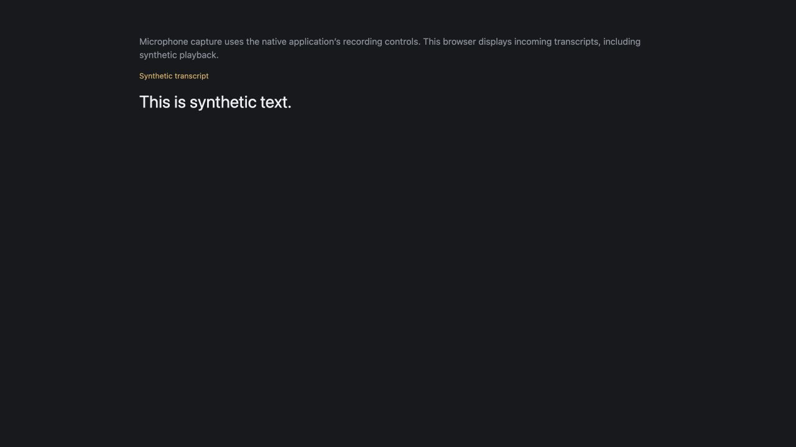

# Released v0.28.3 updater on untouched edited v0.27.0 input

**One normal released update succeeded**, including the production web/Go build
and macOS synthetic compilation. Regular browser computer use subsequently
observed the feeder's final synthetic transcript. The original held baseline and
four authored receipts remain unchanged. This is updater and browser evidence;
no new native UI, microphone, Apple recognition or physical-device claim follows.

## Release and invocation

SKGo v0.28.3 resolves to `2edb21c8947bb7ccd8ec973e221abfcef8242884`;
[release gate 38038084197](https://github.com/tylergannon/skgo/actions/runs/38038084197)
succeeded. The independent released host installed normally with Go 1.27.2;
[install receipt](install-receipt.json), [host buildinfo](host-buildinfo.json)
and [unchanged final buildinfo](host-buildinfo-after.json) retain its identity.

The untouched edited baseline is
`/private/tmp/skgo-recorder-consumer.GthvK4/edited-update-consumer`.
Its 120 regular-file hashes exactly match the preserved
[v0.28.2 baseline](../released-update-v0.28.2/baseline-before.json).
A fresh disposable copy at
`/private/tmp/recorder-update-v0283-5s0_m457/UpdatedFieldNotes` matched all 120
before invocation. Product identity remains FieldNotes, `example.com/field-notes`,
`com.example.fieldnotes`. [Paths](paths.json), [baseline before](baseline-before.json),
[copy before](consumer-before.json). No source/manifest prerequisite patches,
template replay, private package-manager wrapper or development completion
override was used.

```sh
env VP_HOME=/private/tmp/skgo-recorder-consumer.GthvK4/update-isolated-home/vp \
  GOWORK=off CI=1 GOBIN=/private/tmp/recorder-update-v0283-5s0_m457/host \
  /private/tmp/recorder-update-v0283-5s0_m457/host/skgo update \
  --root /private/tmp/recorder-update-v0283-5s0_m457/UpdatedFieldNotes \
  --vp /private/tmp/skgo-recorder-consumer.GthvK4/update-isolated-home/vp/bin/vp \
  --native-platform macos --native-preset synthetic
```

[Exact argv/environment and hashes](invocation.json), [complete output](update.log),
[exit 0 and completion time](update-result.json). Any internal completion argument
in subprocess diagnostics belongs to the updater; the caller used only this
normal top-level command. The native vendor VitePlus 1.0.0 binary is the same
SHA256 previously [verified against its official distribution](https://github.com/tylergannon/skgo-template-voice-recorder/blob/73010529030d23ae1cc3347d0f04b05fd4a55c3a/ephemeral/validation/released-v0.28.1/vp-provenance.json).

## Actual fresh-package exception

The selected npm adapter was **0.28.2**, published at
**2026-10-10 07:53:32.028 UTC**. The update began at
**08:53:38.775275 UTC**, age **3606.747 seconds (60.1 minutes)**;
it ended at 08:54:23.914185 UTC. Go and npm publications have separate versions.
[Registry metadata captured before invocation](publication-before.json),
[selected version and age calculation](selected-adapter-age.json).

The log explicitly reports adding one release-age exception,
`@skgo/sveltekit-adapter@0.28.2`. Unlike the previous normal v0.28.2 attempt,
the authored-config guard accepted this change and completion succeeded.
The [actual source diff](original-source-changes.diff) and
[workspace before](before-web-pnpm-workspace.yaml)/[after](after-web-pnpm-workspace.yaml)
retain the exact addition. This exercised an actual fresh-package exception;
success was not inferred from waiting for a publication to age out.
The effective policy window duration was not measured.

## Completion, checks and runtime

`update.log` records existing VitePlus dependency alignment, adapter 0.28.2,
sv add-on 0.17.1, pnpm 12.9.1 and Kit 3.0.0 with its prerender queue patch.
Production web/Go build and macOS synthetic xcodebuild both completed, ending
with `BUILD SUCCEEDED`. [App buildinfo](app-buildinfo.txt) and
[resolved project Go tool buildinfo](project-tool-buildinfo.json) identify SKGo
v0.28.3. [Product paths and SHA256](products.json) identify the server actually
run and compiled native executable. Neither was installed on the phone.

Go tests and Svelte diagnostics passed (zero errors/warnings):
[exit receipts](check-results.json), [Go log](consumer-go-tests.log),
[sync](svelte-sync.log), [Svelte check](svelte-check.log).
The initial ordinary `just test` **refused ambient pnpm 12.10.1**, because the
project pins 12.9.1; [original refusal](frontend-tests.log) remains retained.
The same recipe then passed all **11 tests in four files** through the qualified
vendor command `vp env exec --package-manager pnpm@12.9.1 just test`:
[exact command](qualified-frontend-command.json),
[output](qualified-frontend-tests.log), [exit 0](qualified-frontend-result.json).
No manifest was weakened and the update was not rerun. [Tool observations](toolchain.json)
distinguish ambient Node 26.11.0 from VitePlus-reported Node 24.21.0. The failed
guess of a project-local `bin/skgo` is diagnostic only; the subsequent Go tool
resolution receipt identifies the actual executable. The add-on version is a
CLI log observation, not an installed `sv` package claim.

The built server ran at `http://127.0.0.1:8198/`. The external feeder accepted
six provisional/final submissions, closed the synthetic session and acknowledged
`This is synthetic text.`: [feeder output](feeder.log), [exit 0](feeder-result.json).
Regular CUA browser observation showed that final text, the stopped state and
the Synthetic transcript label: [accessibility observation](web-synthetic-ax.txt).
This screenshot was captured through the regular computer controls:



This verifies final synthetic text delivery, not visual observation of every
intermediate revision or native recording controls. The owned server was stopped
and verification tab closed; [server cleanup receipt](server-cleanup.json).

## Preservation and bounds

[Preservation](preservation.json) compares all 120 original input paths before
and after. Only seven changed: go.mod, go.sum, internal/skgo/skgo_gen.go,
web/package.json, web/pnpm-lock.yaml, web/pnpm-workspace.yaml and
web/skgo.remotes.json. [After hashes of original paths](original-input-paths-after.json)
and the full source diff retain that scope; build products and new generated
paths are not included in this original-input comparison.

All four [previous authored receipts](prior-authored-receipts.json)—README.md,
native/Sources/ApplicationView.swift, native/skgo-native.json and
web/src/lib/TranscriptScreen.svelte—match before, after update and
[after checks](authored-receipts-post-checks.json). The original held baseline
also remains byte-identical across its 120 entries: [baseline after](baseline-after.json).

The v0.28.2 refusal remains its historical observation. This new success supplies
released updater evidence for #297 on the preserved edited recorder input.
Native UI was not attempted while the desktop awaited unlock; a native compile
does not establish native runtime. Earlier v0.27.0 native/phone observations
retain their original build identities. No Voice Notes promise verdict is changed
by this supplemental update qualification. Managed installer #299 remains separate.
